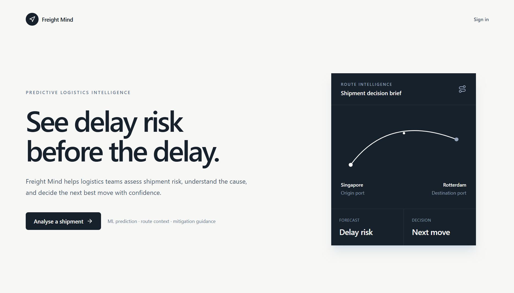

# Freight Mind

### Predictive delay intelligence for modern logistics

Freight Mind helps logistics teams identify shipment delay risk before it becomes a costly operational problem. Describe a shipment in plain language and receive a focused decision brief: predicted delay, risk drivers, live conditions, financial exposure, and recommended next steps.



## The challenge

Shipment delays rarely have a single cause. Port congestion, weather disruption, route conditions, and market volatility can combine quickly, leaving teams to react after the impact is already visible.

Freight Mind turns those fragmented signals into a single, understandable risk assessment so teams can act earlier and with more confidence.

## What Freight Mind delivers

- **Delay-risk forecasting** - Estimates the likelihood and expected duration of shipment delays using Random Forest and XGBoost models.
- **Explainable predictions** - Highlights the most influential factors with SHAP-based model explanations.
- **Live route context** - Incorporates destination weather and relevant logistics signals into each assessment.
- **Financial exposure** - Estimates holding cost, penalties, and revenue at risk.
- **Actionable mitigation** - Produces clear next steps and compares transportation alternatives.
- **Route visualization** - Shows the shipment route on an interactive OpenFreeMap map.

## How it works

```text
Shipment query
      v
Express API -> Weather and news signals
      v
FastAPI ML service -> Delay forecast and SHAP factors
      v
AI assessment -> Mitigations and mode comparison
      v
Freight Mind dashboard
```

1. The user enters a shipment description, such as: `Electronics from Shanghai to Rotterdam, ETA 14 days.`
2. Freight Mind extracts route and shipment context, then collects relevant external signals.
3. The ML service returns a delay forecast, risk score, and explainable contributing factors.
4. The platform generates an operational brief with financial impact and recommended response options.

## Product experience

The dashboard gives operators one place to understand a shipment:

- Risk score and predicted delay
- Financial impact breakdown
- Destination weather and logistics signals
- Interactive origin-to-destination route map
- Risk factors, mitigation actions, and mode comparison

## Technology

| Area | Technology |
| --- | --- |
| Frontend | React, Vite, Tailwind CSS |
| Backend | Node.js, Express |
| Machine learning | Python, FastAPI, scikit-learn, XGBoost, SHAP |
| AI assessment | OpenAI API |
| Data | Supabase PostgreSQL |
| External signals | OpenWeather, NewsAPI |
| Mapping | MapLibre GL JS, OpenFreeMap |

## Project structure

```text
Freight-Mind/
|- client/              # React dashboard and landing page
|- server/              # Express API and orchestration layer
|- ml-service/          # FastAPI inference service and trained models
|- supabase_setup.sql   # Database schema
|- .env.example         # Environment configuration template
`- image.png            # Product preview used in this README
```

## Getting started

### Prerequisites

- Node.js 18+
- Python 3.11+
- Supabase project
- API keys for OpenAI, OpenWeather, and NewsAPI

### 1. Install dependencies

```bash
npm install --prefix server
npm install --prefix client
python -m venv ml-service/venv
ml-service/venv/Scripts/pip install -r ml-service/requirements.txt
```

### 2. Configure services

Copy the environment template and add your credentials:

```bash
copy .env.example .env
```

Run `supabase_setup.sql` in the Supabase SQL editor to create the predictions table.

### 3. Start Freight Mind

Open three terminals in the repository root:

```bash
npm run ml
npm run server
npm run client
```

Open [http://localhost:5173](http://localhost:5173) to use the application.

## Local services

| Service | URL |
| --- | --- |
| Freight Mind web app | `http://localhost:5173` |
| Express API | `http://localhost:5000` |
| ML inference service | `http://localhost:8001` |

